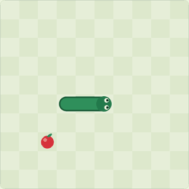
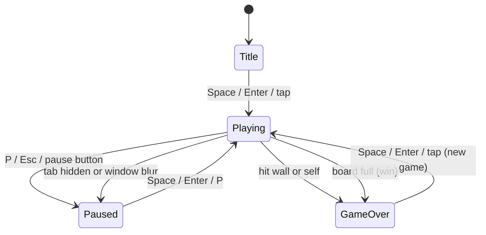
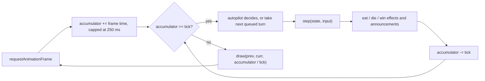
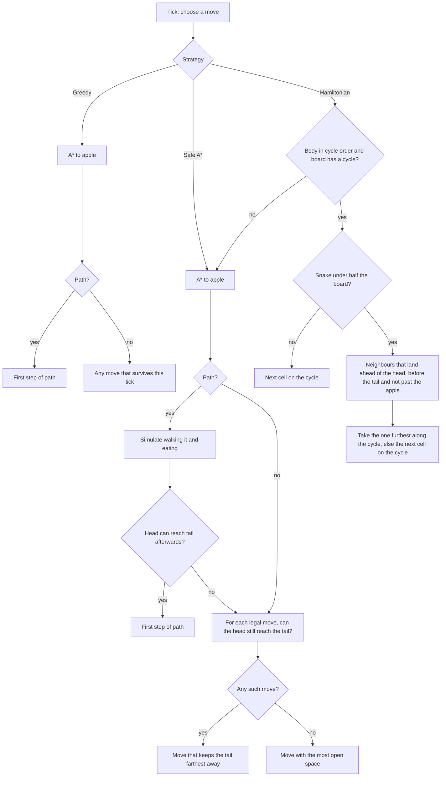

# Snake Autopilot

Snake in TypeScript with an autopilot that plans its moves with A\*, checks them against a
"can I still reach my tail" safety test, and can fill the whole board by following a
Hamiltonian cycle with shortcuts.



**Live demo:** https://shashank11yadav.github.io/Snake-game/ (live once GitHub Pages is enabled for the repo)

## Controls

| Action           | Keyboard                | Touch                              |
| ---------------- | ----------------------- | ---------------------------------- |
| Start, resume    | `Space` or `Enter`      | Tap the board, or the Start button |
| Steer            | Arrow keys or `W A S D` | Swipe on the board, or the d-pad   |
| Pause            | `P` or `Esc`            | Pause button                       |
| Sound on/off     | `M`                     | Speaker button                     |
| Autopilot on/off | `I`                     | "Watch the AI play" switch         |

Steering while the autopilot is driving hands control back to you. The game also pauses
by itself when the tab is hidden or the window loses focus.

The settings panel picks the autopilot strategy, toggles the planned-path overlay, and sets
walls or wrap-around edges, board size (10, 16 or 20 cells a side) and speed (6 to 40 moves
a second). Settings and the best score per edge mode and board size are saved in
`localStorage`. Games where the autopilot drove at any point do not count toward the best
score.

## How it works

The code is split into a pure engine, the autopilot, and a thin browser layer.

- `src/engine/` knows nothing about the DOM. `step(state, input)` takes an immutable game
  state and returns the next one. Randomness comes from a 32-bit seeded PRNG whose state is
  part of the game state, so a seed plus a list of inputs replays a game exactly. This is
  what makes the tests, the benchmark and the demo GIF reproducible.
- `src/ai/` contains the strategies. Each one is a function from a game state to a
  direction plus the path it intends to take.
- `src/ui/` and `src/main.ts` run the loop, draw the canvas, read input, play sounds and
  save settings.

### Game loop and states

The loop uses a fixed timestep: `requestAnimationFrame` adds the elapsed time to an
accumulator, the game advances in whole ticks of `1000 / speed` ms, and the leftover
fraction of a tick is used to slide the snake's head and tail between cells when drawing.
Game speed is the same on a 60 Hz and a 144 Hz screen, and movement still looks smooth.





Input goes through a queue of at most two turns. Each new turn is checked against the last
queued direction rather than the current one, so pressing Up then Left within one tick
makes a clean U-turn, while Up then Down (a reversal hidden inside the buffer) is dropped.

Food is placed by counting the free cells and picking the k-th one, which is uniform over
free cells and always terminates, even when one cell is left. A chi-square test in
`tests/engine.test.ts` checks the distribution.

### The autopilot

Four strategies, from naive to provably safe:

1. **Greedy A\***: shortest path to the apple, treating the body as walls (except the tail
   tip, which moves away on the next tick). If there is no path, any move that survives this
   tick.
2. **Safe A\***: plans the same path, then simulates the snake walking it and eating. The
   path is only taken if the simulated snake's head can still reach its tail, because a snake
   that can reach its tail can follow it forever and never get trapped. If the check fails,
   it chases its tail instead, choosing the move that keeps the tail farthest away (a cheap
   stand-in for the longest safe path, which is NP-hard). If even that is impossible, it
   moves toward the most open space.
3. **Hamiltonian cycle**: a fixed loop through every cell. Following it can never collide,
   but an apple can be almost a full lap away.
4. **Hamiltonian + shortcuts**: follows the same cycle but skips ahead when that is provably
   safe. The invariant is that the body, read from tail to head, sits in increasing cycle
   order within one lap. Then every cell ahead of the head up to the tail is empty, so any
   neighbour that lands strictly between the head and the tail (in cycle order) keeps the
   invariant. It never jumps past the apple, and it stops taking shortcuts once the snake
   covers half the board (see the sweep below for why).



The cycle is a "comb": snake left and right through columns 1 to n-1 row by row, then
return up column 0. It closes when the row count is even; with an odd row count and an even
column count the same shape is built on the transposed board. When both sides are odd no
Hamiltonian cycle exists (colour the grid like a chessboard: a cycle has to alternate colours,
so it needs an even number of cells), and the strategy falls back to Safe A\*. It also falls
back when the autopilot takes over mid-game from a body that is not in cycle order.

The planned-path overlay shows what the current strategy intends to do next. For the cycle
strategies it replays the shortcut rule on a virtual snake until it reaches the apple.

## Autopilot results

`npm run bench` plays seeded games with no DOM and prints these tables. Same seeds for every
strategy, walls mode, snake starts at length 3, so the maximum score is cells minus 3. A game
counts as **stalled** if no apple is eaten in four laps of the board (Safe A\* can circle its
tail forever without dying). **Moves per apple** counts moves up to the last apple eaten.
Times are from Node 26 on an Apple Silicon laptop and include the engine step.

**10 x 10 board, 200 games** (`npm run bench -- --games 200 --size 10`)

| Strategy                | Avg score | Median | Board filled | Died | Stalled | Moves per apple | Time per move |
| ----------------------- | --------: | -----: | -----------: | ---: | ------: | --------------: | ------------: |
| Greedy A\*              |      27.7 |     28 |           0% |  200 |       0 |             7.8 |        3.0 µs |
| Safe A\*                |      96.2 |     97 |          65% |    0 |      71 |            17.5 |        8.7 µs |
| Hamiltonian cycle       |      97.0 |     97 |         100% |    0 |       0 |            25.2 |        0.4 µs |
| Hamiltonian + shortcuts |      97.0 |     97 |         100% |    0 |       0 |            14.9 |        0.6 µs |

**20 x 20 board, 50 games** (`npm run bench -- --games 50 --size 20`)

| Strategy                | Avg score | Median | Board filled | Died | Stalled | Moves per apple | Time per move |
| ----------------------- | --------: | -----: | -----------: | ---: | ------: | --------------: | ------------: |
| Greedy A\*              |      66.8 |     68 |           0% |   50 |       0 |            16.0 |        6.3 µs |
| Safe A\*                |     394.6 |    395 |          46% |    0 |      27 |            56.7 |       29.9 µs |
| Hamiltonian cycle       |     397.0 |    397 |         100% |    0 |       0 |            99.8 |        0.8 µs |
| Hamiltonian + shortcuts |     397.0 |    397 |         100% |    0 |       0 |            51.9 |        1.2 µs |

What the numbers say:

- Greedy is the most efficient while it lives (fewest moves per apple) and dies in every
  game, on average 29% of the way to a full board on 10 x 10 and 17% on 20 x 20.
- The safety check removes deaths entirely. What is left is stalling: near the end the snake
  can circle its tail forever because the last apples are never safe to reach.
- The plain cycle always wins but is slow. Shortcuts keep the guarantee and cut the moves
  per apple by 41% on 10 x 10 and 48% on 20 x 20.

**When to stop taking shortcuts** (`npm run bench -- --games 200 --size 10 --sweep`).
Every shortcut leaves skipped cells behind the head that stay unusable until the tail passes.
While the snake is long, those holes make it more likely the next apple lands behind the
head, which costs a full lap.

| Shortcuts allowed while snake is under | Board filled | Moves per apple |
| -------------------------------------- | -----------: | --------------: |
| 0% of the board (plain cycle)          |         100% |            25.2 |
| 25% of the board                       |         100% |            17.9 |
| 40% of the board                       |         100% |            15.4 |
| 50% of the board                       |         100% |            14.9 |
| 60% of the board                       |         100% |            15.3 |
| 75% of the board                       |         100% |            17.7 |
| 100% of the board                      |         100% |            22.8 |

## Design decisions

- **Pure engine, immutable state.** Copying a few hundred integers per tick is cheap, and in
  return the autopilot can simulate futures by calling the real `step`, tests compare whole
  states, and the benchmark runs the exact rules the browser uses.
- **Cells as flat integers.** `y * cols + x` is cheap to compare and index into typed arrays,
  which is what keeps a Safe A\* decision under 10 µs on 10 x 10.
- **Safety by reachability, not lookahead.** Searching every future is exponential. "Can the
  head reach the tail after eating" is one BFS and catches the common trap (eating at the end
  of a dead end). It is conservative: it treats the whole body as fixed, so it sometimes
  refuses a path that would have been fine.
- **The Hamiltonian invariant is checked, not assumed.** Before using the cycle the strategy
  confirms the body is in cycle order, in either direction of the cycle. A unit test checks
  the invariant on every move of a full game.
- **Shortcut cutoff chosen by measurement.** The 50% rule came out of the sweep above rather
  than being hard-coded from a write-up, although it agrees with one (see Credits).
- **Vanilla TypeScript and canvas.** The UI is a handful of controls around one canvas, so a
  framework would mostly add bytes. The production JavaScript is 9.4 KB gzipped.
- **TypeScript 6.0, not 7.** TypeScript 7 (the native compiler) is out, but typescript-eslint
  8.71 supports TypeScript below 6.1 only, and type-aware linting was worth more here.
- **CSP added at build time only.** Vite's dev server injects inline styles for hot reload,
  which a strict policy blocks. A small Vite plugin adds the policy to the built page, and
  the end-to-end tests run against that build, so a CSP violation fails the tests.
- **No test hooks in the game.** The end-to-end tests freeze time with Playwright's fake
  clock, advance it tick by tick, and read canvas pixels to find the snake.
- **Procedural graphics and sound.** The board, snake, apple and effects are drawn with
  canvas paths, and sounds are short oscillator tones. The old version shipped 1.5 MB of
  images; this one ships a 286-byte SVG favicon.

### Accessibility

- Everything works from the keyboard, with a visible focus ring. Unknown keys are ignored,
  and keys meant for a focused form control are left to it.
- Score changes (throttled to one every two seconds) and pause are announced through a
  polite live region. Game over and wins go through an assertive one.
- The canvas has a text label describing the board. All controls are real buttons and form
  fields with labels.
- `prefers-reduced-motion` turns off the apple pulse, the eat ring, the screen shake and the
  death flash.
- Light and dark themes follow the system setting and can be switched by hand. Text colours
  pass WCAG AA, and axe-core reports no violations in either theme in the end-to-end tests.

## Running locally

Requires Node 22.12 or newer.

```bash
npm ci
npm run dev          # http://localhost:5500/Snake-game/
npm run build        # type-check and build to dist/
npm run preview      # serve the build on http://localhost:5501/Snake-game/
```

Add `?seed=123` to the URL to make the first game reproducible.

## Testing

```bash
npm test             # Vitest: engine, autopilot, UI logic (84 tests)
npm run test:e2e     # Playwright against the production build, desktop and Pixel 7 viewports
npm run lint         # ESLint with typescript-eslint strict type-checked rules
npm run typecheck
npm run format:check
npm run bench        # headless autopilot benchmark, see the flags above
npm run capture      # re-record docs/autopilot.gif (needs a build and ffmpeg)
```

The unit tests cover movement, growth, wall and self collisions, wrap mode on both axes,
reversal blocking and the input queue, food never landing on the snake, a chi-square test of
food placement, determinism by seed, and a win on a full board. For the autopilot they check
that A\* matches BFS distances, that the cycle construction is a valid Hamiltonian cycle on
several board shapes, that the shortcut strategy fills 10 x 10 on 100 seeds (plus wrap mode,
rectangular boards and 20 x 20) without dying, and that Safe A\* refuses a hand-built trap that
kills Greedy.

## Project structure

```
src/
  engine/          pure game rules: types, grid helpers, seeded PRNG, step()
  ai/              search (A*, BFS, flood fill), strategies, headless game runner
  ui/              renderer, controls, sound, phase machine, timestep math, settings storage
  main.ts          wires the engine, autopilot and UI together
  styles.css       layout and light/dark theme tokens
tests/             Vitest unit tests
e2e/               Playwright tests
bench/bench.ts     autopilot benchmark
scripts/           demo GIF capture
docs/              autopilot.gif
.github/           CI, CodeQL, Pages deploy, Dependabot
```

## Limitations and next steps

- Safe A\* stalls in about a third of 10 x 10 games near the end. A real longest-path
  heuristic (extending the tail path by detours) or a time-aware search that knows when each
  body cell frees up would help.
- The safety check treats the body as static. A search that accounts for cells freeing up as
  the tail moves would accept more paths and eat faster.
- The comb cycle is one fixed shape. Rebuilding the cycle around the current body (as some
  "dynamic Hamiltonian" solvers do) would allow more shortcuts late in the game.
- When the autopilot takes over a body that is out of cycle order, the Hamiltonian strategy
  falls back to Safe A\* and only uses the cycle again if the body happens to line up.
- In wrap mode the snake snaps across the edge instead of sliding through it.
- Best scores live in one browser's `localStorage`. There is no online leaderboard.

## Credits

- A\*: P. E. Hart, N. J. Nilsson and B. Raphael, "A Formal Basis for the Heuristic
  Determination of Minimum Cost Paths" (1968).
- Hamiltonian cycle with shortcuts, including stopping at half the board:
  [John Tapsell, "Nokia 6110 Part 3 – Algorithms"](https://johnflux.com/2015/05/02/nokia-6110-part-3-algorithms/).
- The "path to food only if the tail stays reachable, otherwise follow the tail" idea for Safe
  A\*: the greedy solver in [chuyangliu/snake](https://github.com/chuyangliu/snake).
- Fixed timestep with an accumulator and render interpolation:
  [Glenn Fiedler, "Fix Your Timestep!"](https://gafferongames.com/post/fix_your_timestep/).
- Mulberry32 PRNG by Tommy Ettinger
  ([gist](https://gist.github.com/tommyettinger/46a874533244883189143505d203312c)).
- Accessibility checks by [axe-core](https://github.com/dequelabs/axe-core) via
  `@axe-core/playwright`.

All code, graphics and sounds in this repository are original.

## License

[MIT](LICENSE), copyright (c) 2026 Shashank Yadav.
